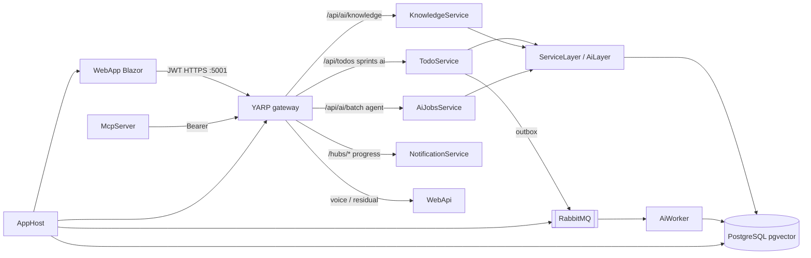

```markdown
# Task Manager — .NET AI Demo

A full-stack **task manager** used to demonstrate practical **AI engineering with .NET**: LLM integrations, embeddings/RAG, Knowledge Lab, voice commands, agents, and MCP — on an **event-driven microservices** layout (YARP gateway, MassTransit, Aspire).

> Demo / portfolio project, not a production SaaS product.

## What this showcases

| Area | Implementation |
|------|----------------|
| Summarization | Short AI summaries of task descriptions |
| Classification | Priority suggestions (guardrails + confidence); **AiWorker** consumer |
| Embeddings | Local **ONNX** `bge-small-en-v1.5` (384-d) → **pgvector**; **AiWorker** consumer |
| Semantic search | Similarity search over todo embeddings (optional hybrid + RRF) |
| RAG | Natural-language Q&A over the user’s tasks (grounded / refuse-empty) |
| Advanced RAG | **Knowledge Lab** — upload docs, chunk + embed, scoped Ask with RAG trace |
| Function calling | Propose ≠ execute tool actions against the API |
| Voice | Hold-to-talk STT (Web Speech / local Whisper) → same tool pipeline |
| Agents (MAF) | **Microsoft Agent Framework** Analyst → Planner; user approves before sprint persist |
| Saga (optional) | Sprint-approve MassTransit saga on **AiJobs** (`EnableSprintApproveSaga`) |
| MCP | Standalone MCP server for Claude Desktop → **YARP gateway** |
| Multi-provider LLMs | Google Gemini, OpenAI, Azure OpenAI, Claude, Ollama |

UI: MudBlazor Blazor WASM. Edge: **YARP** on `:5000`/`:5001`. Orchestration: **.NET Aspire** (Postgres, RabbitMQ, microservices, Speaches/Whisper).

## Architecture

Clients talk only to the **gateway**. Shared libraries (`ServiceLayer`, `AiLayer`, `DataLayer`, …) still hold business/AI code; **hosts** are thin ASP.NET processes behind YARP.

```
src/
├── WebApp/                 # Blazor WASM (MudBlazor, Auth0, Rx state) → Api:Url = gateway
├── AppHost/                # Aspire: Postgres, RabbitMQ, Whisper, YARP, all hosts
├── TodoService/            # /api/todos, /api/sprints, /api/ai/* (RAG, tools, summarize, …)
├── KnowledgeService/       # /api/ai/knowledge/**
├── AiJobsService/          # /api/ai/batch/**, /api/ai/agent/sprint-optimizer/** (+ saga)
├── NotificationService/    # Progress SignalR hubs (/hubs/classification, ai-batch, …)
├── AiWorker/               # MassTransit ClassifyTodo / EmbedTodo consumers
├── WebApi/                 # Residual: voice hub + Swagger catch-all behind gateway
├── ApiHost.Shared/         # Shared host DI / JWT / CORS / pipeline
├── Contracts/              # MassTransit message contracts
├── AiLayer/ · ServiceLayer/ · DataLayer/ · Core/ · ViewModel/
├── McpServer/              # MCP stdio → gateway (Bearer)
└── ServiceDefaults/        # Health, OTel, resilience
```



| Public path | Host |
|-------------|------|
| `/api/todos/**`, `/api/sprints/**`, `/api/ai/**` (except below) | TodoService |
| `/api/ai/knowledge/**` | KnowledgeService |
| `/api/ai/batch/**`, `/api/ai/agent/sprint-optimizer/**` | AiJobsService |
| `/hubs/classification`, `ai-batch`, `sprint-optimizer`, `knowledge-ingest` | NotificationService |
| `/hubs/voice-transcribe` + residual | WebApi |

**Stack highlights:** .NET 10, CQRS + MediatR, Auth0 JWT, EF Core + dual `WriteEfContext` / `ReadEfContext`, MassTransit + EF outbox, Semantic Kernel / Microsoft Agent Framework, Aspire ≥ 13.1.1.

Migration narrative: [`docs/architecture/MIGRATION_PLAN.md`](docs/architecture/MIGRATION_PLAN.md). Agent orientation: [`SOLUTION_OVERVIEW.md`](SOLUTION_OVERVIEW.md).

## Quick start

**Prerequisites:** .NET 10 SDK, Docker (Aspire Postgres/RabbitMQ/YARP/Whisper), Auth0 app configured, an LLM API key.

```bash
# 1) AI key (any API host user-secrets — TodoService is typical for /api/ai)
cd src/TodoService
dotnet user-secrets set "Ai:GoogleAI:ApiKey" "your-key"

# 2) Local embedding model (once)
./scripts/download-bge-onnx.sh

# 3) Run everything (gateway + microservices + WebApp)
dotnet run --project src/AppHost/AppHost.csproj
```

| App | URL |
|-----|-----|
| WebApp | https://localhost:5002 |
| API gateway (Swagger via residual WebApi) | https://localhost:5001/swagger |
| Gateway HTTP | http://localhost:5000 |
| Aspire dashboard | opened by AppHost |
| pgAdmin (optional) | http://localhost:5050 |

WebApp `wwwroot` `Api:Url` must stay `https://localhost:5001/` (WASM cannot read Aspire-injected env). Aspire pins gateway HTTPS with `WithHostHttpsPort(5001)`.

Without Aspire: `docker compose up -d` (Postgres on **5433**), set `ConnectionStrings:MainDb`, run hosts + a reverse proxy yourself — prefer AppHost for day-to-day work. More: [`docs/aspire/README.md`](docs/aspire/README.md).

## AI features (in the UI)

- **Todos** — create/edit tasks; AI summary + priority classification; semantic search toggle; hold-to-talk voice overlay (STT → tools)  
- **AI Chat** — Ask (RAG over todos), Tools (function calling), Optimize Sprint (**MAF** propose → approve/reject)  
- **Knowledge Lab** — upload `.txt`/`.md`, ingest/chunk/embed, scoped document Ask with retrieval trace  
- **Sprints** — list/detail of agent-created sprint plans  

Feature flags live under `Ai:Features` in host `appsettings.json` (e.g. [`src/TodoService/appsettings.json`](src/TodoService/appsettings.json); mirrored on other AI hosts). Include `EnableSprintApproveSaga` for the optional approve saga.

Implementation notes: [`docs/AI_FEATURES.md`](docs/AI_FEATURES.md).

## AI observability (OpenTelemetry)

AI features emit GenAI-oriented traces and metrics on ActivitySource/Meter `TaskManager.Ai` (classify, summarize, RAG, tools, embeddings, sprint optimizer).

| Environment | Where to look |
|---|---|
| **Development (Aspire)** | Aspire Dashboard → Traces / Metrics. Filter for `ai.operation/`*, `ai.llm/*`, `ai.tool/*`. |
| **Production** | Point `OTEL_EXPORTER_OTLP_ENDPOINT` at Grafana Alloy/Tempo (or any OTLP collector). Same instrumentation; no Aspire Dashboard required. |

Config under `Ai:Observability`:

- `Enabled` — master switch  
- `CapturePayloadPreview` — off by default; when on, truncated prompt/response previews may appear on spans  
- `RecordTokenUsage` — records provider token counts when available (often missing for Ollama)

Quality metrics on the same meter: `ai.quality.events` (validation_failed, insufficient_context, tool_arg_rejected, budget_exceeded, ungrounded_answer) and `ai.classify.override_decisions` (band × overridden).

## AI validation and evaluation

**Realtime (every request):** deterministic C# gates — not an LLM judge on the hot path.

| Gate | Where it applies |
|------|------------------|
| `PromptInputSanitizer` | User/LLM-bound text (summarize, classify, RAG, tools, voice, Knowledge Lab) |
| Output validators (`LlmOutputValidator`) | Summary length/empty; RAG refuse-on-empty; Guid / faithfulness grounding (todos + Knowledge Lab); agent text bounds |
| Classification guardrails | Keyword/confidence overrides after the model suggests priority |
| Tool allowlist + `ToolArgumentValidator` | Propose **and** execute; status allowlists where relevant |
| Sprint tool / time budgets | Cap invocations, recovery passes, job timeout / stuck detection |

`LlmJudgeService` exists for **offline** RAG Triad scoring only — it is not registered on Ask / Knowledge Lab request paths.

**Offline fixtures + harnesses** (`src/AiLayer/Evaluation/`):

| File | Purpose |
|------|---------|
| [`samples/ai-eval-todos.csv`](samples/ai-eval-todos.csv) | Classify labels (`ExpectedPriority`) + safety-ish rows |
| [`samples/ai-eval-rag.json`](samples/ai-eval-rag.json) | Todo RAG Triad (context recall / insufficient / ungrounded) |
| [`samples/ai-eval-tool-proposals.json`](samples/ai-eval-tool-proposals.json) | Expected tool names + arg schema |
| [`samples/knowledge-lab/`](samples/knowledge-lab/) | Manual Knowledge Lab matrices (ingest / hybrid / rewrite gaps) — not a CI harness |

**What CI actually runs:** `AiLayer.Tests` loads fixtures and scores with **mocks / heuristics / guardrails-only** (no live LLM). That checks harness wiring and deterministic legs (e.g. insufficient-context message, tool schema fail), not production model quality.

```bash
dotnet test src/Tests/AiLayer.Tests --filter "FullyQualifiedName~ClassificationAccuracyHarnessTests|FullyQualifiedName~RagTriadEvaluatorTests|FullyQualifiedName~ToolProposalEvalHarnessTests|FullyQualifiedName~LlmJudgeServiceTests"
```

`AI_EVAL_LIVE=1` is reserved on `ClassificationAccuracyHarness` for a future live classify pass; it is **not** wired into the tests above yet.

## MCP (Claude Desktop)

Standalone process in `src/McpServer` (stdio). Auth: Auth0 **Device Code** + refresh token (no pasted JWT). Tools: `create_todo`, `update_todo`, `search_todos`, `analyze_workload`. Point the HTTP client at the **gateway** (`https://localhost:5001`), not an individual service.  
Setup: [`docs/mcp/README.md`](docs/mcp/README.md).

## Configuration notes

- Secrets via **user-secrets** / env vars — never commit keys.  
- Aspire injects `ConnectionStrings__MainDb` and RabbitMQ; don’t run Compose Postgres and Aspire Postgres together unless intentional.  
- Prefer `Ai:Agents:ChatModel` = `gemini-2.5-flash` (or OpenAI) for tool-calling agents.  
- Agent budgets (`Ai:Agents`): `MaxToolInvocationsPerJob` (12), `MaxPlannerRecoveryPasses` (1), `JobTimeoutSeconds` (240), `StuckAfterSeconds` (300).  
- Local Aspire: API hosts behind YARP may need `AllowedHosts=*` (AppHost sets this; see `appsettings.Development.json` on microservices).  
- More Aspire detail: [`docs/aspire/README.md`](docs/aspire/README.md).

## License

Demo / learning project. Use and adapt as needed for interviews, workshops, and portfolio demos.

```
