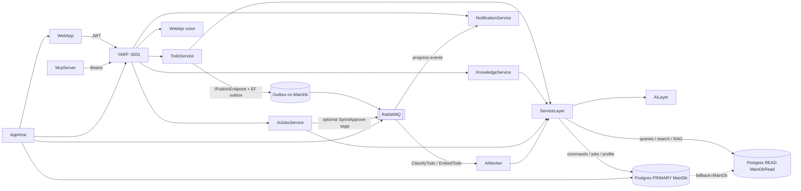

```markdown
# Solution overview (for AI agents)

Orientation brief for coding agents working in this repo.  
Human GitHub overview: [`README.md`](README.md).  
Per-feature AI implementation: [`docs/AI_FEATURES.md`](docs/AI_FEATURES.md).  
Migration phases: [`docs/architecture/MIGRATION_PLAN.md`](docs/architecture/MIGRATION_PLAN.md).

> Demo / portfolio task manager + AI engineering lab — not a production SaaS product.

## What this system is

.NET 10 full-stack **task manager** (todos, sprints) with production-minded AI paths: summarization, classification, local embeddings + pgvector, semantic search, todo RAG, Knowledge Lab (document RAG), function calling, hold-to-talk voice → tools, Microsoft Agent Framework sprint optimizer (propose → user approve), optional sprint-approve **MassTransit saga**, MCP for Claude Desktop, durable AI batch jobs.

**Shape today:** Blazor WASM → **YARP gateway** → bounded-context **hosts** (Todo / Knowledge / AiJobs / Notification / WebApi residual) + **AiWorker** consumers. Shared `MainDb` (per-service DBs deferred). Phases 1–5 of the migration plan are largely in place.

**Solution:** `src/TaskManager.sln`

## Doc map

| Doc | Audience | Contents |
|-----|----------|----------|
| `README.md` | GitHub / humans | Showcase table, quick start, OTel/eval overview |
| `SOLUTION_OVERVIEW.md` | AI agents | Layers, hosts, flow, conventions, where to put code |
| `docs/AI_FEATURES.md` | Engineers / agents | Each AI feature: API, flags, flows, gates, primary types |
| `docs/architecture/MIGRATION_PLAN.md` | Engineers / agents | Phase 1–5 decisions and status |
| `docs/aspire/README.md` | Local run | AppHost ports, Whisper, gateway notes |
| `.cursor/rules/*` | Cursor | Always-on stack / conventions / never-do |

## Project structure

```
src/
├── WebApp/                 # Blazor WASM → gateway Api:Url (https://localhost:5001/)
├── AppHost/                # Aspire: Postgres, RabbitMQ, Whisper, YARP, all projects
├── TodoService/            # Todos, sprints, most /api/ai/* (Ask, tools, summarize, …)
├── KnowledgeService/       # Knowledge Lab HTTP API
├── AiJobsService/          # AI batch + sprint optimizer + SprintApprove saga
├── NotificationService/    # Progress SignalR hubs (classify, batch, sprint, knowledge)
├── AiWorker/               # ClassifyTodo / EmbedTodo MassTransit consumers
├── WebApi/                 # Residual: voice STT hub + Swagger; catch-all behind YARP
├── ApiHost.Shared/         # Shared host wiring (JWT, CORS, pipeline, MediatR host opts)
├── Contracts/              # Bus message contracts (Todo*, SprintApprove*, …)
├── AiLayer/                # Pipelines: summarize, classify, embed, RAG, tools, eval
├── ServiceLayer/           # MediatR handlers, agents, notifiers, consumers/saga helpers
├── DataLayer/              # EF Core + Npgsql / pgvector, Write/Read contexts, migrations
├── Core/ · ViewModel/      # Domain / commands / DTOs / FluentValidation
├── McpServer/              # MCP stdio → gateway as Auth0 user (no direct DB)
├── ServiceDefaults/        # Health, OpenTelemetry, resilience
└── Tests/                  # xUnit
```

## Request flow



Typical path: **WebApp JWT → YARP → host controller → MediatR → ServiceLayer → DataLayer and/or AiLayer → PostgreSQL.**

### YARP route map (AppHost)

| Route | Destination |
|-------|-------------|
| `/hubs/classification/{**}`, `/hubs/ai-batch/{**}`, `/hubs/sprint-optimizer/{**}`, `/hubs/knowledge-ingest/{**}` | NotificationService |
| `/api/ai/knowledge/{**}` | KnowledgeService |
| `/api/ai/batch/{**}`, `/api/ai/agent/sprint-optimizer/{**}` | AiJobsService |
| `/api/todos/{**}`, `/api/sprints/{**}`, `/api/ai/{**}` | TodoService |
| Catch-all (voice hub, Swagger, …) | WebApi |

### Data & messaging (Phases 1–2)

- **WriteEfContext** → `ConnectionStrings:MainDb` (migrations, mutations, jobs, profile).
- **ReadEfContext** → `MainDbRead` or fallback to `MainDb` (lists, semantic/lexical search, RAG reads).
- MassTransit + RabbitMQ; EF transactional outbox on write; contracts in `src/Contracts`.
- Classify/embed side effects: publish on todo create/update → **AiWorker** consumers (not in-process WebApi queues for the happy path).

### Phase 5 saga (optional)

Flag `Ai:Features:EnableSprintApproveSaga`. When on, approve starts MassTransit **SprintApprove** saga on AiJobs (`SprintApproveState`) → Todo `CreateSprintFromProposal` → finalize + `SprintApprovalNotify`. When off, sync approve fallback in the handler. See migration plan Phase 5.

Controllers stay thin: validate `ModelState` → `_mediator.Send(...)` → map domain exceptions to `ProblemDetails`. Use `ControllerBase` only — **no minimal APIs**.

## Layer responsibilities

| Layer / host | Put here | Do not put here |
|--------------|----------|-----------------|
| YARP / AppHost | Routes, ports, references, `AllowedHosts` for Docker Host headers | Business logic |
| Todo / Knowledge / AiJobs / WebApi hosts | Controllers, hub hosting, host DI via `ApiHost.Shared` | Fat business logic in controllers |
| NotificationService | Progress hubs + bus → SignalR notifiers | Domain mutations |
| AiWorker | Classify/embed consumers only | HTTP APIs |
| ServiceLayer | Handlers, agents, saga helpers, access guards usage | Raw HTTP DTOs duplicated outside ViewModel |
| AiLayer | LLM/embed pipelines, sanitizers, validators, SK/MAF helpers | Tenancy/calendar filters that belong in handlers |
| DataLayer | EF config, repos, migrations, saga state mapping | Domain rules / LLM prompts |
| ViewModel | Commands, queries, DTOs, validators | Handlers |
| Core | Aggregates, repo interfaces, shared security | Feature-specific UI |
| WebApp | MudBlazor pages, `*DataService` (HTTP), `*StateService` (Rx) | Duplicate ViewModel contracts; call services bypassing gateway |

## Conventions (must follow)

### API / CQRS

- Commands/queries/validators/DTOs in **ViewModel**; handlers in **ServiceLayer**; repos implement **Core** abstractions in **DataLayer**.
- Naming: `CreateTodoTaskCommand` + `*Handler` + `*Validator`.
- Public IDs: `ExternalId` (`Guid`) — never expose EF `Id` on the API.
- Authz: `TodoAccessGuard` / knowledge owner checks; admin policy `PolicyNames.IsAdmin`.
- Controllers remain `[Authorize]` unless an endpoint is intentionally anonymous.
- Errors: `ProblemDetails` / `ApiErrorResponses` — no stack traces to clients.

### WebApp

- MudBlazor. Split HTTP (`*DataService`) from Rx state (`*StateService`).
- Reuse ViewModel types — do not redefine DTOs/commands on the client.
- Folder spelling for auth/DI helpers: `WebApp/Extentions` (existing).
- `Api:Url` points at the **gateway**, not individual service ports.

### AI

- Sanitize inputs with `PromptInputSanitizer`.
- Validate outputs with `LlmOutputValidator` / classification guardrails.
- Respect `Ai:Features` flags (disabled → 503) and dedicated AI rate-limit policies.
- Feature detail (APIs, knobs, primary code): **`docs/AI_FEATURES.md`**.

### Tests

- xUnit under `src/Tests/*`. Prefer inline fakes over Moq.
- Build/test via `src/TaskManager.sln`.

## Never do

- Commit secrets (API keys, DB passwords) — use user-secrets / env / Key Vault; keep committed `appsettings.json` placeholders empty.
- Fat controllers or `DbContext` in API hosts.
- Drop `[Authorize]` by accident.
- SQL string concatenation — use EF / parameterized queries.
- Skip ownership checks on owned resources.
- Prompt LLMs with unsanitized user text or trust LLM output without validation.
- Bypass `Ai:Features` / AI rate limits on new AI endpoints.
- Duplicate ViewModel contracts in WebApp.
- Point WebApp/MCP at a single microservice port in Aspire local runs (use gateway `:5001`).

## Cross-cutting infrastructure

### Auth

- WebApp: Auth0 OIDC.
- API hosts: JWT Bearer (Auth0 authority/audience) via `ApiHost.Shared`.
- MCP: Auth0 Device Code + refresh → Bearer to **gateway** (same authz as UI).

### Aspire / local run

- Prefer `dotnet run --project src/AppHost/AppHost.csproj`.
- Gateway: http://localhost:5000 · https://localhost:5001 (Aspire ≥ 13.1.1 + `WithHostHttpsPort`).
- WebApp: https://localhost:5002.
- Details: `README.md` quick start; `docs/aspire/README.md`.

### SignalR hubs (authorized)

| Hub | Path | Host (via YARP) |
|-----|------|-----------------|
| Classification | `/hubs/classification` | NotificationService |
| AI batch | `/hubs/ai-batch` | NotificationService |
| Sprint optimizer | `/hubs/sprint-optimizer` | NotificationService |
| Knowledge ingest | `/hubs/knowledge-ingest` | NotificationService |
| Voice transcribe | `/hubs/voice-transcribe` | WebApi |

### Observability

- ActivitySource/Meter: `TaskManager.Ai`
- Config: `Ai:Observability` (payload preview off by default)
- Human-oriented notes: `README.md` (AI observability / validation sections)

## AI feature index (details elsewhere)

Do **not** re-implement feature docs here. See [`docs/AI_FEATURES.md`](docs/AI_FEATURES.md):

1. RAG (todos Ask) · 2. Knowledge Lab · 3. Summarization · 4. Classification · 5. Embeddings · 6. Semantic search · 7. Function calling · 8. Agents / MAF (propose → approve/reject) · 9. MCP · 10. AI batch · 11. Voice

Flags live under `Ai:Features` in host appsettings (e.g. TodoService / KnowledgeService / AiJobsService).

## Key domains (non-AI)

- **Todos** — CRUD, import, owner-scoped access (TodoService).
- **Sprints** — created from approved sprint-optimizer proposals; list/detail in UI (TodoService + optional saga on AiJobs).
- **Knowledge documents** — upload → ingest job → chunks/embeddings → scoped Ask (KnowledgeService).

## When adding a feature

1. Contract in **ViewModel** (command/query + validator + DTO).
2. Handler in **ServiceLayer**; reuse access guards.
3. If AI: pipeline/helpers in **AiLayer**; wire flag + rate limit; sanitize/validate.
4. Thin controller on the **correct host**; ensure AppHost YARP route covers the path (more specific routes before `/api/ai/{**}`).
5. WebApp: extend `*DataService` / `*StateService` + MudBlazor UI; reuse ViewModel types; call gateway only.
6. If async side effects: publish contract + consumer (prefer AiWorker / existing bus patterns) + outbox when mutating with publish.
7. Tests under `src/Tests/*`.
8. If AI behavior changes, update `docs/AI_FEATURES.md`.

---

**Target:** .NET 10 · **Status:** demo / learning portfolio · **Architecture:** gateway + microservices (shared MainDb)

```
