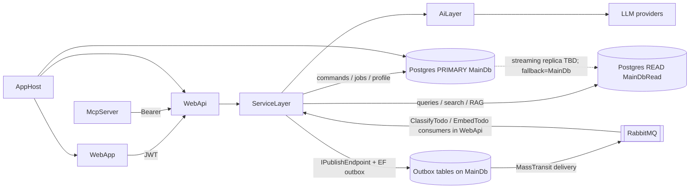

# Solution overview (for AI agents)

Orientation brief for coding agents working in this repo.  
Human GitHub overview: [`README.md`](README.md).  
Per-feature AI implementation: [`docs/AI_FEATURES.md`](docs/AI_FEATURES.md).

> Demo / portfolio task manager + AI engineering lab — not a production SaaS product.

## What this system is

.NET 10 full-stack **task manager** (todos, sprints) with production-minded AI paths: summarization, classification, local embeddings + pgvector, semantic search, todo RAG, Knowledge Lab (document RAG), function calling, hold-to-talk voice → tools, Microsoft Agent Framework sprint optimizer (propose → user approve), MCP for Claude Desktop, durable AI batch jobs.

**Solution:** `src/TaskManager.sln`

## Doc map

| Doc | Audience | Contents |
|-----|----------|----------|
| `README.md` | GitHub / humans | Showcase table, quick start, OTel/eval overview |
| `SOLUTION_OVERVIEW.md` | AI agents | Layers, flow, conventions, where to put code |
| `docs/AI_FEATURES.md` | Engineers / agents | Each AI feature: API, flags, flows, gates, primary types |
| `.cursor/rules/*` | Cursor | Always-on stack / conventions / never-do |

## Project structure

```
src/
├── WebApp/            # Blazor WASM (MudBlazor, Auth0 OIDC, Rx *StateService)
├── WebApi/            # ASP.NET Core API (JWT, Swagger, SignalR, rate limits)
├── AiLayer/           # Pipelines: summarize, classify, embed, RAG, tools, eval harnesses
├── ServiceLayer/      # MediatR handlers, agents, background jobs/queues
├── DataLayer/         # EF Core + Npgsql / pgvector, repositories, migrations
├── Core/              # Domain, abstractions, AutoMapper, security helpers
├── ViewModel/         # Commands, queries, DTOs, FluentValidation
├── McpServer/         # MCP stdio → WebApi as Auth0 user (no direct DB)
├── AppHost/           # .NET Aspire orchestrator
├── ServiceDefaults/   # Health, OpenTelemetry, resilience
└── Tests/             # xUnit (AiLayer.Tests, ServiceLayer.Tests, …)
```

## Request flow



Typical path: **WebApp JWT → controller → MediatR → ServiceLayer handler → DataLayer and/or AiLayer → PostgreSQL.**

**Phase 1 CQRS data access:** `WriteEfContext` → `ConnectionStrings:MainDb` (migrations, mutations, jobs, profile). `ReadEfContext` → `MainDbRead` or fallback to `MainDb` (lists, semantic/lexical search, RAG reads).

**Phase 2 messaging:** MassTransit + RabbitMQ (Aspire `rabbitmq`); EF transactional outbox on `WriteEfContext`; contracts in `src/Contracts` (`TodoCreated` / `TodoUpdated` / `TodoDeleted`). Classify/embed consumers run in-process in WebApi (worker extract in Phase 4). Update publishes AI side effects only when title/description change.

**Phase 3 read models:** Streaming replica / same schema is enough — list, get, search, and RAG keep using `ReadEfContext` against `MainDbRead` (or primary fallback). **No** denormalized projection tables; custom projectors remain under “Decisions to revise later.”

**Phase 4 (mostly done):** Aspire **YARP** routes `/hubs/*` progress → `notifications`; `/api/ai/knowledge/**` → `knowledge`; `/api/ai/batch/**` + sprint-optimizer → `aijobs`; `/api/todos|sprints|ai/**` → `todo`; residual (voice hub) → `webapi`. **AiWorker** classify/embed. Shared `MainDb` for now (D44 per-service DB later).

**Phase 5:** Cross-service choreography (classify/embed/notify). Optional **sprint-approve MassTransit saga** on AiJobs (`SprintApproveState` EF store) → Todo `CreateSprintFromProposal` → finalize + `SprintApprovalNotify`. Flag: `Ai:Features:EnableSprintApproveSaga` (sync approve fallback when off). See [`docs/architecture/MIGRATION_PLAN.md`](docs/architecture/MIGRATION_PLAN.md).

Controllers stay thin: validate `ModelState` → `_mediator.Send(...)` → map domain exceptions to `ProblemDetails`. Use `ControllerBase` only — **no minimal APIs**.

## Layer responsibilities

| Layer | Put here | Do not put here |
|-------|----------|-----------------|
| WebApi | Controllers, hubs, auth/rate-limit wiring | Business logic, `DbContext` |
| ServiceLayer | Handlers, agents, background services, access guards usage | Raw HTTP DTOs duplicated outside ViewModel |
| AiLayer | LLM/embed pipelines, sanitizers, validators, SK/MAF helpers | Tenancy/calendar filters that belong in handlers |
| DataLayer | EF config, repos, migrations | Domain rules / LLM prompts |
| ViewModel | Commands, queries, DTOs, validators | Handlers |
| Core | Aggregates, repo interfaces, shared security | Feature-specific UI |
| WebApp | MudBlazor pages, `*DataService` (HTTP), `*StateService` (Rx) | Duplicate ViewModel contracts |

## Conventions (must follow)

### API / CQRS

- Commands/queries/validators/DTOs in **ViewModel**; handlers in **ServiceLayer**; repos implement **Core** abstractions in **DataLayer**.
- Naming: `CreateTodoTaskCommand` + `*Handler` + `*Validator`.
- Public IDs: `ExternalId` (`Guid`) — never expose EF `Id` on the API.
- Authz: `TodoAccessGuard` / knowledge owner checks; admin policy `PolicyNames.IsAdmin`.
- Controllers remain `[Authorize]` unless an endpoint is intentionally anonymous.
- Errors: `ProblemDetails` / `ApiErrorResponses` — no stack traces to clients.

### WebApp

- MudBlazor. Split HTTP (`*DataService`) from Rx state (`*StateService`).
- Reuse ViewModel types — do not redefine DTOs/commands on the client.
- Folder spelling for auth/DI helpers: `WebApp/Extentions` (existing).

### AI

- Sanitize inputs with `PromptInputSanitizer`.
- Validate outputs with `LlmOutputValidator` / classification guardrails.
- Respect `Ai:Features` flags (disabled → 503) and dedicated AI rate-limit policies.
- Feature detail (APIs, knobs, primary code): **`docs/AI_FEATURES.md`**.

### Tests

- xUnit under `src/Tests/*`. Prefer inline fakes over Moq.
- Build/test via `src/TaskManager.sln`.

## Never do

- Commit secrets (API keys, DB passwords) — use user-secrets / env / Key Vault; keep committed `appsettings.json` placeholders empty.
- Fat controllers or `DbContext` in WebApi.
- Drop `[Authorize]` by accident.
- SQL string concatenation — use EF / parameterized queries.
- Skip ownership checks on owned resources.
- Prompt LLMs with unsanitized user text or trust LLM output without validation.
- Bypass `Ai:Features` / AI rate limits on new AI endpoints.
- Duplicate ViewModel contracts in WebApp.

## Cross-cutting infrastructure

### Auth

- WebApp: Auth0 OIDC.
- WebApi: JWT Bearer (Auth0 authority/audience).
- MCP: Auth0 Device Code + refresh → Bearer to WebApi (same authz as UI).

### Aspire / local run

- Prefer `dotnet run --project src/AppHost/AppHost.csproj` (Postgres, WebApi, WebApp, optional Speaches/Whisper).
- Without Aspire: Compose Postgres (often port **5433**) + run WebApi/WebApp separately.
- Details: `README.md` quick start; Aspire notes in `docs/aspire/README.md`.

### SignalR hubs (authorized)

| Hub | Path | Purpose |
|-----|------|---------|
| Classification | `/hubs/classification` | Classify job progress |
| AI batch | `/hubs/ai-batch` | Batch job progress |
| Sprint optimizer | `/hubs/sprint-optimizer` | MAF job progress |
| Voice transcribe | `/hubs/voice-transcribe` | Chunked STT while holding mic |
| Knowledge ingest | `/hubs/knowledge-ingest` | Document ingest progress |

### Observability

- ActivitySource/Meter: `TaskManager.Ai`
- Config: `Ai:Observability` (payload preview off by default)
- Human-oriented notes: `README.md` (AI observability / validation sections)

## AI feature index (details elsewhere)

Do **not** re-implement feature docs here. See [`docs/AI_FEATURES.md`](docs/AI_FEATURES.md):

1. RAG (todos Ask) · 2. Knowledge Lab · 3. Summarization · 4. Classification · 5. Embeddings · 6. Semantic search · 7. Function calling · 8. Agents / MAF (propose → approve/reject) · 9. MCP · 10. AI batch · 11. Voice

Flags live under `Ai:Features` in `src/WebApi/appsettings.json`.

## Key domains (non-AI)

- **Todos** — CRUD, import, owner-scoped access.
- **Sprints** — created from approved sprint-optimizer proposals; list/detail in UI.
- **Knowledge documents** — upload → ingest job → chunks/embeddings → scoped Ask.

## When adding a feature

1. Contract in **ViewModel** (command/query + validator + DTO).
2. Handler in **ServiceLayer**; reuse access guards.
3. If AI: pipeline/helpers in **AiLayer**; wire flag + rate limit; sanitize/validate.
4. Thin **WebApi** controller endpoint; map exceptions.
5. WebApp: extend `*DataService` / `*StateService` + MudBlazor UI; reuse ViewModel types.
6. Tests under `src/Tests/*`.
7. If AI behavior changes, update `docs/AI_FEATURES.md`.

---

**Target:** .NET 10 · **Status:** demo / learning portfolio
